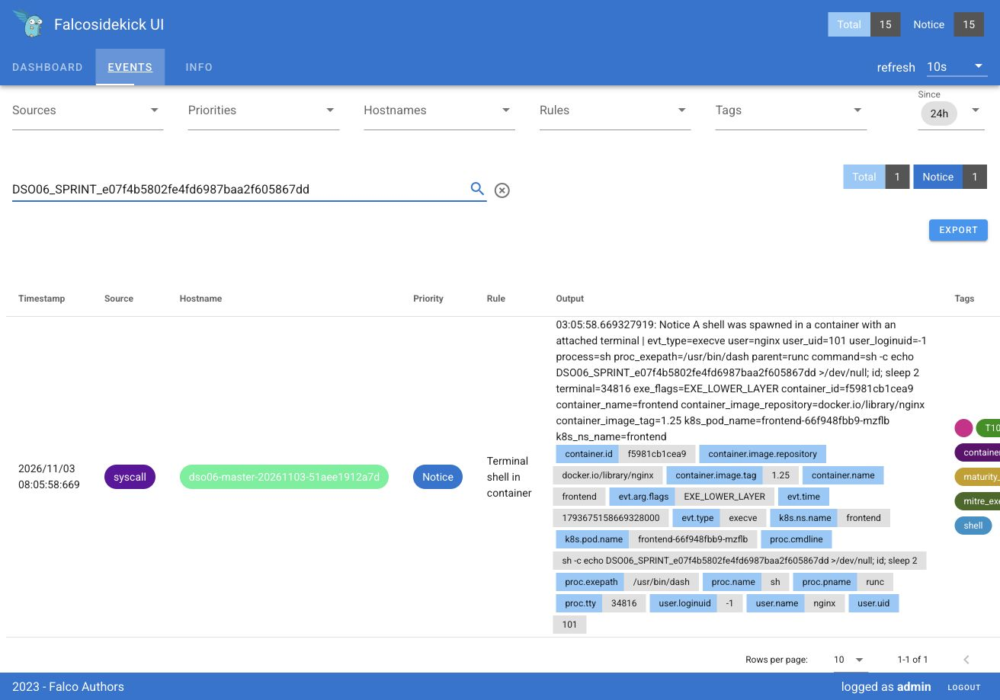

# Отчёт о безопасности Kubernetes

Стенд DSO-06: Ubuntu 22.04.5, Kubernetes 1.31.2, Calico; один Ready узел. Исходные приложения: frontend `nginx:1.25`, backend `postgres:15`. Проверки выполнены 03.11.2026; время в логах — UTC.

## 1. Диагностика и аудит

Использованы `kubectl` с JSONPath для Pod/Deployment, ServiceAccount, ConfigMap, переменных окружения и RBAC. Значения credentials в отчёте не выводятся.

| Тип | Namespace | Ресурс | Риск | Приоритет |
|---|---|---|---|---|
| Привилегированный контейнер | backend | Deployment/backend | Доступ к возможностям узла, выход из контейнера | Критический |
| Пароль в ConfigMap | backend | ConfigMap/db-config, ключ password | Раскрытие credentials через чтение конфигурации | Высокий |
| Plaintext env | frontend | Deployment/frontend, DB_PASSWORD | Пароль доступен в спецификации и истории ревизий | Высокий |
| default ServiceAccount | frontend | Deployment/frontend | Общая идентичность с избыточными правами через binding | Высокий |
| Wildcard RBAC | frontend, backend / cluster-scoped | ClusterRole/unsafe-role; ClusterRoleBinding/unsafe-binding-frontend и unsafe-binding-backend | Любые операции над всеми ресурсами кластера от обоих default SA | Критический |

До исправления `kubectl auth can-i '*' '*'` с impersonation default SA возвращал `yes` для обоих namespace. Backend также использовал default SA. Выполнен `kubescape scan framework nsa` с JSON-выводом.

Доказательства: [инвентаризация](screenshots/evidence/vm/run-20261103/00-inventory.txt), [JSONPath до](screenshots/evidence/vm/run-20261103/01-audit-before.txt), [can-i до/после](screenshots/evidence/vm/run-20261103/02-rbac.txt), [NSA baseline JSON](screenshots/evidence/vm/run-20261103/kubescape-before.json), [лог](screenshots/evidence/vm/run-20261103/kubescape-before.log).

## 2. Исправление RBAC

В frontend созданы ServiceAccount/frontend-sa, Role/frontend-reader и RoleBinding/frontend-reader. Role разрешает только `get/list` для pods/services в frontend, wildcard отсутствует. Backend переведён на отдельный backend-sa без дополнительных разрешений. У обоих приложений отключено монтирование SA token.

Удалены оба небезопасных ClusterRoleBinding и ClusterRole/unsafe-role. Проверки учитывают группы ServiceAccount при impersonation.

| Проверка | После |
|---|---|
| frontend-sa: get/list pods, services в frontend | yes |
| frontend-sa: create/delete pods | no |
| frontend-sa: get secrets | no |
| frontend-sa: get pods в backend | no |
| default SA frontend и backend: wildcard | no |
| default SA frontend и backend: get secrets | no |

Доказательства: [полный can-i и удаление binding](screenshots/evidence/vm/run-20261103/02-rbac.txt), [итоговая проверка](screenshots/evidence/vm/run-20261103/09-final-verification.txt).

## 3. Миграция секретов

В frontend и backend создан отдельный Secret/db-secret типа Opaque с ключами `username`, `password` в `data` base64. Frontend использует DB_USERNAME/DB_PASSWORD, backend — POSTGRES_USER/POSTGRES_PASSWORD; все credentials подключены через `secretKeyRef` к Secret своего namespace. ConfigMap/backend/db-config удалён.

Внутри контейнеров проверено непустое значение обеих переменных без вывода содержимого. Backend выполнил `SELECT 1` по TCP с credentials из env. Прежние last-applied annotations и неактивные ReplicaSet с открытыми credentials удалены.

В применённых манифестах используются вымышленные учебные значения. Base64 не является шифрованием; encryption at rest в рамках задания не настраивалось.

Доказательства: [миграция, ссылки Secret и SQL](screenshots/evidence/vm/run-20261103/03-secrets.txt), [JSONPath после](screenshots/evidence/vm/run-20261103/08-audit-after.txt), [итоговая проверка](screenshots/evidence/vm/run-20261103/09-final-verification.txt).

## 4. Pod Security

В обоих Deployment настроены `runAsNonRoot: true`, `seccompProfile: RuntimeDefault`, `allowPrivilegeEscalation: false`, `privileged: false`, `readOnlyRootFilesystem: true`, `capabilities.drop: [ALL]` и ограничения ресурсов. Frontend работает с UID/GID 101, backend — 999; UID проверены внутри контейнеров.

Nginx слушает 8080, Service сохраняет порт 80. Записываемые временные каталоги вынесены в `emptyDir`. PostgreSQL использует `emptyDir` для данных и сокета. Проверены HTTP frontend и SQL backend.

В backend включён PSA `enforce=baseline`, `enforce-version=v1.31`. Попытка **создать** privileged Pod получила:

```text
Forbidden: violates PodSecurity "baseline:v1.31": privileged
```

Проверено отсутствие тестового Pod. PSA предотвращает создание новых опасных Pod; старые экземпляры заменены rollout. Предупреждение при включении PSA относилось к завершающемуся старому Pod; в итоговом состоянии привилегированных контейнеров приложений нет.

Доказательства: [SecurityContext, UID, SQL и Admission rejection](screenshots/evidence/vm/run-20261103/04-pod-security.txt), [финальные Pod](screenshots/evidence/vm/run-20261103/09-final-verification.txt).

## 5. NetworkPolicy

В frontend и backend установлены default-deny для Ingress и Egress. Для frontend разрешены DNS к CoreDNS kube-system по UDP/TCP 53 и Egress к backend на TCP 5432. Backend разрешает Ingress TCP 5432 только от frontend. Namespace selector и Pod selector находятся в одном peer, поэтому должны совпасть оба условия.

| Проверка | Результат |
|---|---|
| Сторонний Pod → backend Pod IP:5432 до политик | PostgreSQL accepting connections |
| Тот же Pod → backend после политик | no response, pg_isready exit 2 |
| frontend → backend Service:5432 после политик | TCP соединение установлено |
| frontend → DNS имени backend | Успешно |
| frontend → собственный HTTP listener | HTTP успешно |
| backend → localhost:5432 | PostgreSQL accepting connections |

Сторонний Pod имеет метку `app=frontend`, но находится в namespace attacker-test. Проверка завершения `pg_isready` отличает сетевую блокировку от ошибки `kubectl exec`. Положительная TCP-проба прекращается при ошибке соединения (`bash -ec`). Тестовый namespace удалён до повторного сканирования.

Доказательства: [до/после политик](screenshots/evidence/vm/run-20261103/05-network.txt), [повторные проверки](screenshots/evidence/vm/run-20261103/05-network-repeat.txt), [манифесты NetworkPolicy](manifests/vm/secure/50-network.yaml).

## 6. Kubescape и Falco

Оба NSA-сканирования выполнены Kubescape 4.0.16 с одинаковыми NSA policy, control inputs и exceptions. SHA-256 входных файлов сохранены в логе after; используются `--keep-local`, `--host-scan=false`, `--fail-on-degraded-config` и один контекст кластера. Набор из 26 control ID совпадает.

| Метрика | До | После |
|---|---:|---:|
| FAIL controls всего кластера | 19 | 19 |
| OK controls всего кластера | 5 | 5 |
| Пропущенные controls | 2 | 2 |
| Compliance score | 53,88% | 56,92% |
| Failed-пары ресурс/control в frontend/backend | 23 | 0 |
| C-0012, failed resources всего кластера | 5 | 3 |
| C-0057, failed resources всего кластера | 5 | 4 |
| C-0013, failed resources всего кластера | 25 | 23 |
| C-0016, failed resources всего кластера | 15 | 13 |
| C-0030, failed resources всего кластера | 30 | 28 |

Общее число FAIL controls осталось прежним: эти controls продолжают находить нарушения в инфраструктурных namespace. Для frontend/backend failed-записи устранены. Вручную исправлены RBAC, Secrets, SecurityContext и NetworkPolicy. Автоматическое предотвращение повторной опасной конфигурации доказано отказом PSA из шага 4.

Доказательства: [before JSON](screenshots/evidence/vm/run-20261103/kubescape-before.json), [after JSON](screenshots/evidence/vm/run-20261103/kubescape-after.json), [полная таблица controls и ресурсов](screenshots/evidence/vm/run-20261103/comparison.md), [лог after](screenshots/evidence/vm/run-20261103/kubescape-after.log).

### Falco

Использованы предустановленные Falco 0.45.2 и Falcosidekick UI 2.2.0. Обычное правило `Terminal shell in container` зарегистрировало запуск shell с TTY в frontend: 03.11.2026 03:05:58 UTC, UID 101, source syscall, priority Notice. Команда содержит уникальный маркер `DSO06_SPRINT_e07f4b5802fe4fd6987baa2f605867dd`.

[Вывод запуска](screenshots/evidence/vm/run-20261103/07-falco-trigger.txt) и [JSON события Falco](screenshots/evidence/vm/run-20261103/07-falco-events.json) соответствуют событию в UI:



UI показывает локальное время 08:05:58 (UTC+5). Использовано штатное правило Falco без изменения конфигурации мониторинга.

### Ограничения

Coverage Kubescape — 83,31% в обоих запусках. C-0069/C-0070 не оценены без operator KubeletInfo; host scan отключён. Неполный охват и отсутствие облачных API отражены в логах. Оставшиеся FAIL включают системный RBAC, privileged/hostNetwork инфраструктурных агентов, настройки encryption/audit и устаревшего ingress; системные компоненты в рамках задания не изменялись. Успешный тест PSA оценивается по Admission rejection: устаревший контроль PSP C-0068 сам по себе не подтверждает состояние PSA.

Falco подтверждает одно воспроизводимое syscall-событие; это не проверка полного набора runtime-детектов. PostgreSQL использует непостоянное учебное хранилище; производственная сохранность данных не входит в эту конфигурацию.

## До/После

| Область | До | После |
|---|---|---|
| Backend privilege | privileged=true | privileged=false, non-root UID 999 |
| Контейнеры приложений | Нет защитного контекста | Non-root, no escalation, seccomp, drop ALL, read-only root |
| Пароль в backend ConfigMap | db-config | ConfigMap удалён, Secret/db-secret |
| Frontend credentials | plaintext env | secretKeyRef |
| Идентичность frontend | default SA | frontend-sa, Role get/list pods/services |
| Wildcard default SA | Разрешён в обоих namespace | Оба binding и unsafe-role удалены, can-i=no |
| Privileged Pod | Допускался исходной конфигурацией | PSA baseline отклоняет создание |
| Сеть | Нет изоляции | Default-deny, DNS и frontend→backend TCP 5432 |
| Сторонний Pod → backend | Доступен | Заблокирован |
| Failed-пары frontend/backend | 23 | 0 |

[Итоговая проверка](screenshots/evidence/vm/run-20261103/09-final-verification.txt) подтверждает Ready Pod, SA, Secret references, UID, SecurityContext, NetworkPolicy, PSA и применимость всех secure-манифестов через server-side dry-run. Инструкция воспроизведения — в [README.md](README.md).
